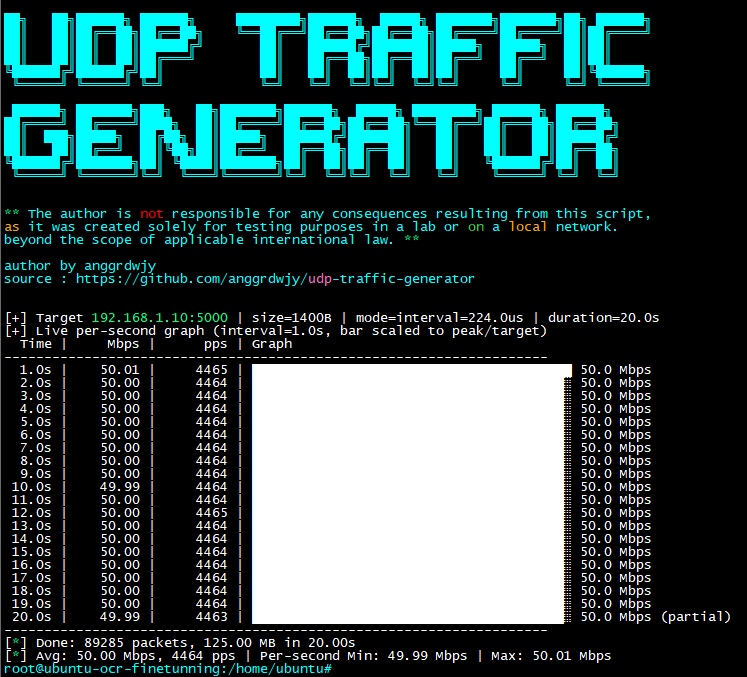

## Information

The author is not responsible for any consequences resulting from this script, as it was created solely for testing purposes in a lab or on a local network. Beyond the scope of applicable international law.


<p align="left">

</p>

#### Quick Start
```
chmod +x multiple_ipscan.py

python3 udp-traffic-gen-v2.py -t 192.168.1.10 -p 5000 -r 50 -d 20
```

#### Usage
```
usage: udp-traffic-gen-v2.py [-h] -t TARGET [-p PORT] [-s SIZE] [-d DURATION] [-r RATE] [--pps PPS] [--flood] [--ttl TTL] [--tos TOS] [--stat-interval STAT_INTERVAL] [--bar-width BAR_WIDTH] [--csv-file CSV_FILE] [--no-banner]

UDP one-way traffic generator with per-second graph

options:
  -h, --help            show this help message and exit
  -t, --target TARGET   Target IP
  -p, --port PORT       Target UDP port (default 5001)
  -s, --size SIZE       Payload size in bytes (default 1400, max 65507)
  -d, --duration DURATION
                        Duration in seconds (default 10)
  -r, --rate RATE       Target rate in Mbps (default 0 = flood)
  --pps PPS             Target packets per second (alternative to rate)
  --flood               Send as fast as possible without pacing
  --ttl TTL             Packet TTL (default 64)
  --tos TOS             TOS/DSCP, e.g. 184 = EF (default 0)
  --stat-interval STAT_INTERVAL
                        Stats interval in seconds (default 1.0)
  --bar-width BAR_WIDTH
                        Width of the ASCII bar chart (default 40)
  --csv-file CSV_FILE   Optional CSV file for per-second stats (e.g. traffic.csv)
  --no-banner           Hide the startup banner
```

#### Support

* [:octocat: Follow me on GitHub](https://github.com/anggrdwjy)
* [🔔 Subscribe me on Youtube](https://www.youtube.com/@anggarda.wijaya)

## License

This project is licensed under the **MIT License**—it is free to use, modify, and distribute, including for commercial purposes, as long as you include the copyright notice and this license.

See the full file at [`LICENSE`](LICENSE).
